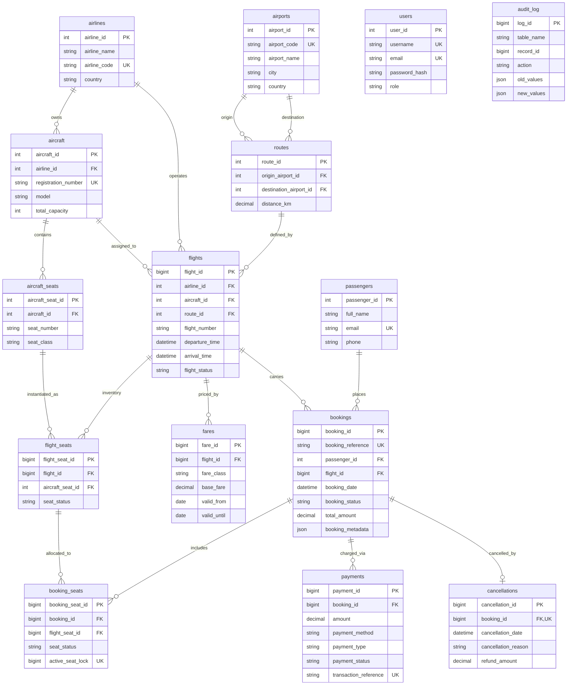

# AIR-FLOW: Database Design Specification

Database Name: `air_flow_db`  
DBMS: MySQL 8.0+ (InnoDB Engine, utf8mb4)  
Schema Count: 14 Domain & User Tables + 1 Supporting Audit Table

---

## Entity Relationship Diagram (Mermaid ERD)

---

## Detailed Table Dictionary

### 1. `airlines`
- `airline_id`: `INT AUTO_INCREMENT PRIMARY KEY`
- `airline_name`: `VARCHAR(100) NOT NULL`
- `airline_code`: `VARCHAR(5) NOT NULL UNIQUE`
- `country`: `VARCHAR(60)`
- `created_at`: `TIMESTAMP DEFAULT CURRENT_TIMESTAMP`

### 2. `airports`
- `airport_id`: `INT AUTO_INCREMENT PRIMARY KEY`
- `airport_code`: `CHAR(3) NOT NULL UNIQUE` (IATA)
- `airport_name`: `VARCHAR(150) NOT NULL`
- `city`: `VARCHAR(80)`
- `country`: `VARCHAR(60)`

### 3. `aircraft`
- `aircraft_id`: `INT AUTO_INCREMENT PRIMARY KEY`
- `airline_id`: `INT NOT NULL FK -> airlines(airline_id)`
- `registration_number`: `VARCHAR(20) NOT NULL UNIQUE`
- `model`: `VARCHAR(80) NOT NULL`
- `total_capacity`: `INT NOT NULL CHECK (total_capacity > 0)`

### 4. `aircraft_seats`
- `aircraft_seat_id`: `INT AUTO_INCREMENT PRIMARY KEY`
- `aircraft_id`: `INT NOT NULL FK -> aircraft(aircraft_id)`
- `seat_number`: `VARCHAR(5) NOT NULL`
- `seat_class`: `ENUM('ECONOMY', 'BUSINESS', 'FIRST') NOT NULL`
- **Constraint**: `UNIQUE(aircraft_id, seat_number)`

### 5. `routes`
- `route_id`: `INT AUTO_INCREMENT PRIMARY KEY`
- `origin_airport_id`: `INT NOT NULL FK -> airports(airport_id)`
- `destination_airport_id`: `INT NOT NULL FK -> airports(airport_id)`
- `distance_km`: `DECIMAL(10,2)`
- **Constraint**: `CHECK (origin_airport_id <> destination_airport_id)`

### 6. `flights`
- `flight_id`: `BIGINT AUTO_INCREMENT PRIMARY KEY`
- `airline_id`: `INT NOT NULL FK -> airlines(airline_id)`
- `aircraft_id`: `INT NOT NULL FK -> aircraft(aircraft_id)`
- `route_id`: `INT NOT NULL FK -> routes(route_id)`
- `flight_number`: `VARCHAR(10) NOT NULL`
- `departure_time`: `DATETIME NOT NULL`
- `arrival_time`: `DATETIME NOT NULL`
- `flight_status`: `ENUM('SCHEDULED', 'BOARDING', 'COMPLETED', 'CANCELLED') DEFAULT 'SCHEDULED'`
- **Constraint**: `CHECK (arrival_time > departure_time)`

### 7. `flight_seats`
- `flight_seat_id`: `BIGINT AUTO_INCREMENT PRIMARY KEY`
- `flight_id`: `BIGINT NOT NULL FK -> flights(flight_id)`
- `aircraft_seat_id`: `INT NOT NULL FK -> aircraft_seats(aircraft_seat_id)`
- `seat_status`: `ENUM('AVAILABLE', 'BOOKED', 'BLOCKED') DEFAULT 'AVAILABLE'`
- **Constraint**: `UNIQUE (flight_id, aircraft_seat_id)`

### 8. `passengers`
- `passenger_id`: `INT AUTO_INCREMENT PRIMARY KEY`
- `full_name`: `VARCHAR(120) NOT NULL`
- `email`: `VARCHAR(150) NOT NULL UNIQUE`
- `phone`: `VARCHAR(20)`
- `created_at`: `TIMESTAMP DEFAULT CURRENT_TIMESTAMP`

### 9. `bookings`
- `booking_id`: `BIGINT AUTO_INCREMENT PRIMARY KEY`
- `booking_reference`: `VARCHAR(10) NOT NULL UNIQUE`
- `passenger_id`: `INT NOT NULL FK -> passengers(passenger_id)`
- `flight_id`: `BIGINT NOT NULL FK -> flights(flight_id)`
- `booking_date`: `DATETIME NOT NULL DEFAULT CURRENT_TIMESTAMP`
- `booking_status`: `ENUM('PENDING', 'CONFIRMED', 'CANCELLED') DEFAULT 'PENDING'`
- `total_amount`: `DECIMAL(12,2) NOT NULL DEFAULT 0.00 CHECK (total_amount >= 0)`
- `booking_metadata`: `JSON` (flexible attributes: channel, meal, baggage)

### 10. `booking_seats`
- `booking_seat_id`: `BIGINT AUTO_INCREMENT PRIMARY KEY`
- `booking_id`: `BIGINT NOT NULL FK -> bookings(booking_id)`
- `flight_seat_id`: `BIGINT NOT NULL FK -> flight_seats(flight_seat_id)`
- `seat_status`: `ENUM('HELD', 'CONFIRMED', 'CANCELLED') DEFAULT 'HELD'`
- `active_seat_lock`: `BIGINT AS (CASE WHEN seat_status IN ('HELD', 'CONFIRMED') THEN flight_seat_id ELSE NULL END) STORED`
- **Constraint**: `UNIQUE (flight_seat_id, active_seat_lock)`

### 11. `payments`
- `payment_id`: `BIGINT AUTO_INCREMENT PRIMARY KEY`
- `booking_id`: `BIGINT NOT NULL FK -> bookings(booking_id)`
- `amount`: `DECIMAL(12,2) NOT NULL CHECK (amount > 0)`
- `payment_method`: `VARCHAR(30)`
- `payment_type`: `ENUM('PAYMENT', 'REFUND') DEFAULT 'PAYMENT'`
- `payment_status`: `ENUM('PENDING', 'SUCCESS', 'FAILED') DEFAULT 'PENDING'`
- `transaction_reference`: `VARCHAR(40) NOT NULL UNIQUE`
- `payment_date`: `DATETIME NOT NULL DEFAULT CURRENT_TIMESTAMP`

### 12. `fares`
- `fare_id`: `BIGINT AUTO_INCREMENT PRIMARY KEY`
- `flight_id`: `BIGINT NOT NULL FK -> flights(flight_id)`
- `fare_class`: `ENUM('ECONOMY', 'BUSINESS', 'FIRST') NOT NULL`
- `base_fare`: `DECIMAL(12,2) NOT NULL CHECK (base_fare > 0)`
- `currency`: `CHAR(3) DEFAULT 'INR'`
- `valid_from`: `DATE NOT NULL`
- `valid_until`: `DATE NULL`
- **Constraint**: `CHECK (valid_until IS NULL OR valid_until >= valid_from)`

### 13. `cancellations`
- `cancellation_id`: `BIGINT AUTO_INCREMENT PRIMARY KEY`
- `booking_id`: `BIGINT NOT NULL UNIQUE FK -> bookings(booking_id)`
- `cancellation_date`: `DATETIME NOT NULL DEFAULT CURRENT_TIMESTAMP`
- `cancellation_reason`: `VARCHAR(255)`
- `refund_amount`: `DECIMAL(12,2) NOT NULL DEFAULT 0.00 CHECK (refund_amount >= 0)`

### 14. `users` (Authentication)
- `user_id`: `INT AUTO_INCREMENT PRIMARY KEY`
- `username`: `VARCHAR(50) NOT NULL UNIQUE`
- `email`: `VARCHAR(150) NOT NULL UNIQUE`
- `password_hash`: `VARCHAR(255) NOT NULL` (bcrypt)
- `role`: `ENUM('ADMIN', 'ANALYST') DEFAULT 'ANALYST'`
- `created_at`: `TIMESTAMP DEFAULT CURRENT_TIMESTAMP`

### 15. `audit_log` (Supporting Trigger Table)
- `log_id`: `BIGINT AUTO_INCREMENT PRIMARY KEY`
- `table_name`: `VARCHAR(50) NOT NULL`
- `record_id`: `BIGINT NOT NULL`
- `action`: `ENUM('INSERT', 'UPDATE', 'DELETE') NOT NULL`
- `old_values`: `JSON`
- `new_values`: `JSON`
- `changed_at`: `TIMESTAMP DEFAULT CURRENT_TIMESTAMP`
- `changed_by`: `VARCHAR(50) DEFAULT 'SYSTEM'`

